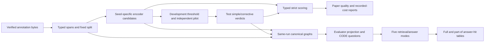

# Reading the CODE-ACCORD artifact

Start with the three root commands. They select a scientific workflow and call
stage controllers; model implementation is below those controllers. A fresh
clone contains everything needed to read the method and run offline validation.
The parent research repository is not a runtime or test dependency.

| Read first | Then follow | Scientific implementation |
|---|---|---|
| [pipeline.py](../pipeline.py) | [preparation](../stages/preparation.py), [encoder](../stages/encoder.py), [verifier](../stages/verifier.py), [evaluation](../stages/evaluation.py) | Annotation reconstruction, canonical training, requests/verdicts and strict scoring |
| [encoder_comparison.py](../encoder_comparison.py) | [comparison_matrix.py](../stages/comparison_matrix.py), [encoder_comparison.py](../stages/encoder_comparison.py) | Four historical-derived arms, separate trainer/network |
| [rag.py](../rag.py) | [stages/rag.py](../stages/rag.py) | Same-run graphs, question panels, retrieval and frozen answer evaluation |

Read [workflow.md](workflow.md) for command/continuation contracts and
[encoder-comparison.md](encoder-comparison.md) for the four arms. The public
`validate` actions contact no model. A clean source checkout and matching
actual input/model identities are required for execution and continuation.

## Follow the scientific data

1. [acquisition.py](../utils/preparation/acquisition.py) verifies immutable
   archive bytes. [annotations.py](../utils/preparation/annotations.py) reads
   entity BIO labels and relation markers, repairs the single audited malformed
   ID, and aligns arguments to unique typed spans. Unresolved alignment remains
   in the audit rather than silently becoming strict gold.
   [split.py](../utils/preparation/split.py) fixes CODE-SPLIT-1.
   [materialization.py](../utils/preparation/materialization.py) writes scientific
   sentence/gold rows, split identities, distributions and eligibility evidence.
2. [network.py](../utils/encoder/network.py) defines canonical model heads.
   [data.py](../utils/encoder/data.py) defines tokenization, span/pair construction
   and durable sampling. [trainer.py](../utils/encoder/trainer.py) contains
   `compute_span_loss`, `evaluate_span` and the unchanged optimizer loop in
   `main`. Development evaluation selects checkpoints; test quality never selects
   a checkpoint or threshold. Seeds are 42–49.
3. [options.py](../utils/encoder/options.py) makes internal worker values
   explicit. [model.py](../utils/encoder/model.py) owns input/checkpoint/candidate
   contracts, [inference.py](../utils/encoder/inference.py) runs the model, and
   [candidates.py](../utils/encoder/candidates.py) converts the raw ledger.
   Development and test prediction explicitly use `add_prefix_space=True` for
   pre-split words, matching canonical training and comparison prediction.
   Comparison training and both prediction splits share their own `_tokenizer`:
   both DeBERTa profiles set this flag; BERT retains its WordPiece settings.
   Greedy non-overlapping span selection and the confidence product
   `min(head_probability, tail_probability) * relation_probability` are preserved.
4. [threshold.py](../utils/verifier/threshold.py) selects from development data.
   [requests.py](../utils/verifier/requests.py) binds the exact source sentence,
   candidate, literal prompt/schema and decoding payload.
   [pilot.py](../utils/verifier/pilot.py) authenticates independent development
   captures. [interpretation.py](../utils/verifier/interpretation.py) validates
   response actions and maps corrected spans back to source tokens.
   The pilot admits source-valid correction emissions and rejected corrections
   with no emitted triple. Ambiguous, out-of-source and unchanged corrections
   retain their rejection statuses; malformed responses, inconsistent emissions,
   repeat mismatches and invalid lineage still block execution. Audit revision
   1.1 records this admission rule and the original response distributions.
   [verifier.py](../utils/verifier/verifier.py) owns transport, original attempts,
   timings and durable response continuation.
5. [scoring.py](../utils/evaluation/scoring.py) compares typed strict tuples and
   separates candidate decisions from final emitted triples. Duplicate emitted
   triples collapse under the existing definition. [metrics.py](../utils/evaluation/metrics.py)
   computes counts/P/R/F1. [statistics.py](../utils/evaluation/statistics.py)
   retains the existing uncertainty, exact Wilcoxon, paired-t sensitivity and
   Holm families. [tables.py](../utils/evaluation/tables.py) renders existing
   publication products; [reporting.py](../utils/evaluation/reporting.py) exposes
   additional views of available measurements without model work.
6. [runner.py](../utils/rag/runner.py) authenticates the completed same-run
   parent and actual Qwen identity. [graph.py](../utils/rag/graph.py) builds
   confidence/corrective/gold canonical graphs and `project_graph` converts them
   into the evaluator view. [code_questions.py](../utils/rag/code_questions.py)
   defines the seven added templates once and preserves the original `part-of`
   generator. [evaluator.py](../utils/rag/evaluator.py) retains the five modes,
   question order, literal prompts, non-thinking decoding and answer matching.
   Fresh retrieval uses ordered list frontiers; generation uses the explicit
   seed in [table2.json](../resources/contracts/table2.json).
   [journal.py](../utils/rag/journal.py)
   saves ordered occurrences and original answers around that kernel.
   [requests.py](../utils/rag/requests.py) observes the actual selected context
   and verifies the saved request without performing retrieval again.

## Records and one real trace

[records.py](../utils/common/records.py) defines `EntitySpan`, `StrictTriple`,
`Candidate` and `Verdict`. Span positions are inclusive token indices; strict
identity includes example, endpoint positions/types and relation. Candidate IDs
join encoder products to verifier responses. Source text/document anchors and
functional join IDs remain scientific/provenance content. Canonical graphs use
typed source-grounded identities; evaluator projection uses surface nodes/edges.
These are different representations, with the transform explicit in source.

The [reading-trace fixture](../tests/fixtures/reading-trace.json) records one
returned seed-42 example from run `09-22`, with original source-file hashes and
precise row locations. It is documentation evidence, never a runtime input.

> The smaller dimension of each panel which can be either the width or height
> of the panel should be 230mm or less.

| Step | Retained observation | Code to inspect |
|---|---|---|
| Prepared sentence | Example `0096a3bf-ac16-4a75-adf9-8c3f4a9b8610`; `dimension` at token 2 is Property, `panel` at token 5 is Object | Annotation alignment and materialization |
| Candidate | `(dimension, part-of, panel)`, seed 42, confidence `0.47286` | `_sentence_candidates` and `Candidate` |
| Corrective verdict | `KEEP`, reason `SUPPORTED`, no correction | `_parse_content` and strict scoring |
| Graph projection | Edge `dimension --part-of--> panel` | `build_table_graphs`, `project_graph` |
| Returned question/result | `What is dimension part of?`; corrective `kg_1hop` predicts `panel`, gold `panel`, `correct=true` | Question generation and `check_answer` |

The candidate matches retained typed gold and contributes one true positive to
that seed/condition's strict counts. The returned answer contributes one hit to
its mode/condition denominator. This worked trace is not an aggregate experiment
or proof that generation faithfully used its source. Retained text bindings
were verified; missing binary/cache objects prevent complete local validation
of the old parent's lineage. The expanded RAG parity discrepancy remains
unresolved. Neither limitation is repaired by this example.

## Four comparison arms and preserved quirks

The comparison uses its own [network](../utils/encoder_comparison/network.py)
and [trainer](../utils/encoder_comparison/trainer.py), bounded from the historical
result-producing implementation. It is not a generalization of canonical
training. Read the finite [configuration](../resources/configs/encoder-comparison.json)
for BERT-base/common, DeBERTa-base/common, DeBERTa-large/common and
DeBERTa-large/A20+A21+A12. Only Table-1 encoder results are in scope.

The frozen CODE behavior uses `NO_REL=1.0`. A20 decays linearly from 5× to 2×;
its one-time adaptive gate's middle 3.5× value lasts one batch. A21 smooths
span-NER labels and A12 uses inter-span context. Apparently unused initialized
heads remain because removing them can alter parameter keys and RNG order.
Tests check these details rather than silently replacing them with paper prose.

All four one-step CUDA/restart/candidate smokes precede full training. All 32
development runs precede any final-test outcome access. The coordinator and
private workers enforce membership and gates, and smoke/full processes are
isolated. The fresh command directly advances validated prerequisites without
a manual admission artifact. Earlier partial G-05 runs keep their pinned
pre-refactor review/finalization procedure and original namespaces.

## Minimum lineage and failure behavior

Read [paths.py](../utils/common/paths.py) for run-bound path refusal,
[artifact_io.py](../utils/common/artifact_io.py) for canonical bytes/hashes,
[execution.py](../utils/common/execution.py) for OS locks and failed/resumed
invocation accounting, and [runtime.py](../utils/encoder/runtime.py) for the
once-per-run numerical environment. Producer receipts reference actual source,
input/output hashes, cache/weight/tokenizer identities and durable state.
Restart states and completion summaries bind the run, source, prepared inputs,
recipe/cache and numerical runtime. Private workers require their coordinator's
active recorded dispatch; canonical and comparison namespaces stay separate.
Qwen weight SHA-256/byte size, model/quantization settings, Python/Ollama/Torch/
Transformers and numerical backend settings remain visible. Historical reference
digests, hardware and branch ancestry are not fresh admission criteria.
Fresh source identity comes from the clean Git commit and selected tracked
resource paths. No separate hashes or copied definitions identify tracked
configuration, templates, schemas or method code. External inputs, generated
artifacts, requests and actual model bytes retain their same-run hash bindings.

Repeat a command unchanged after failure. Complete outputs are authenticated;
unsaved steps can run again; pure finalization requires identical existing
bytes. Verifier's original three-attempt budget and terminal failure verdicts
survive continuation. Independent pilot captures never share answers. RAG
reuses saved successful occurrences and retries only unfinished empty/error
answers. Missing contemporaneous model proof fails closed; later queries cannot
create past proof. A completed seedless request plan replays read-only; an
unfinished one cannot dispatch using the new generation policy.
Corrupt or foreign progress stops rather than becoming a new
run. Concurrent execution fails without deleting lock files or evidence.
Saved response hashes and original model evidence are checked before new calls.
Missing completed journals, changed outputs or a prediction ledger without its
original producer receipt require explicit disposition; they are never silently
adopted or recreated. RAG continuation keeps recorded condition time across
segments and leaves completed output bytes unchanged.

### RAG request and process evidence

Under `output/<run-id>/table2-code-all/`, each condition's
`calls/<condition>/requests.json` stores each full prompt once, its question/mode
identity, ordered retrieved triples and included triples, retrieved sentences
and included source excerpts. Retrieved graph lists retain the evaluator's
15-fact return cap; one-hop/two-hop include those lists and hybrid includes the
first five one-hop facts. Both graph frontiers follow node/edge first appearance
in the authenticated projected graph; sets are membership checks only. Ordering
is fixed before either fact cap, without reference to gold answers or results.
Text retrieval retains up to three sentences, with
the original 200-character excerpt boundary; hybrid includes the first excerpt
and preserves its empty source bullet when nothing is retrieved. Observation
does not repeat retrieval. The plan and live dispatcher share the configured
temperature, output-token limit and explicit generation seed.

The plan hashes UTF-8 prompt bytes, canonical ordered-context JSON without a
trailing newline, and the exact outgoing request JSON. It retains the selected
model and derives fixed role/options/serialization from the recorded source
commit. `request_bytes` reconstructs
the original request serialization, including ASCII escapes, field order and
spacing, from saved evidence alone. Each occurrence's `001-request.json` is
durable before dispatch; its answer and model proof bind that request record's
hash. Later attempts use the next attempt number and retain earlier failures
and interrupted dispatch records. Requests reference a common
`calls/producers/<process-id>.json` record for the actual producing process and
same-run source/model identity. The plan's retrieval producer and a resumed
attempt's dispatch producer can therefore differ without changing saved context.

[process_identity.py](../utils/common/process_identity.py) supplies only an
immutable original producer token shared by that process's calls. No hash-seed,
startup-environment or interpreter diagnostics are logged. Ordered traversal
makes those observations unnecessary; selected context stays in the request plan.

Completed historical journals may replay their validated original responses
without adding new metadata. Their missing ordered-context or startup evidence
stays unavailable. An unfinished historical plan lacks the evidence required
for new dispatch and fails closed; continuation does not reconstruct past
context or relabel a later process as its producer.

Completed outputs retain their original measured times. Future fresh calls
measure the current execution, including the added journal writes; the offline
replay proof does not claim identical live wall time or model answers.

## Read the automatic paper reports

Canonical reports are `metrics/paper-report/paper-statistics.{json,tsv,md}`;
comparison reports are each arm's `reports/comparison/` plus coordinator
`reports/matrix/`; RAG reports are `table2-code-all/reports/`. Each has a manifest
binding original input hashes and the rendered products. JSON retains full
precision; TSV/Markdown expose the same values without additional rounding.

Strict quality includes per-seed counts/P/R/F1, descriptive mean/sample SD,
all tied best seeds and existing raw/Holm-adjusted sensitivity tests. Best
final-test values do not select a model or change an experiment. Corpus reports
include split/country/span/relation distributions and alignment eligibility;
emitted unique triples remain separate from candidate count and graph counts.

The matrix report applies the four predeclared paired-seed comparisons from
the comparison configuration. [comparison_statistics.py](../utils/evaluation/comparison_statistics.py)
uses the existing exact two-sided Wilcoxon test and Holm adjustment, plus the
approved 10,000 shared PCG64 seed draws and linear-percentile 95% intervals.
Missing arms or seed values withhold the complete contrast family. Reports
authenticate each arm identity and identical split/gold hashes. These intervals
describe training-seed variation on the fixed test set; recorded sentence-like
source IDs do not establish independent regulation-document clusters.

Canonical reports also retain the development-only threshold trace. Saved
candidate confidence and original emitted keys supply the joint selected-cutoff
plus simple-verifier row, percentage-point changes and the descriptive 0.5
cutoff sensitivity rows. Strict keys collapse after filtering and all gold
denominators remain. These views change neither the four-condition scientific
scorer and its significance family nor the chosen operating point.

Training reports sum recorded final-invocation seconds per seed into wall hours
and separately expose original finished process timings, including failed
attempts and earlier invocations where retained. These views overlap and must
not be added. Matrix smoke and full execution costs are separate; starts with
no finish have unavailable durations. Request reports count original
uncached attempts, retries and failures, sum measured seconds/tokens and show
coverage separately for warmup, pilot and test. No original response is relabelled
as a cache hit on resume. RAG reports full and `part-of` correct/total/hit rates
for every mode/condition, canonical versus projected graph scale and retained
condition wall time. Gold is a nondeployable oracle; these diagnostics are not
the paper's original ten-question Table 2.
RAG reports recount frozen answer-hit flags and record paired one-hop/hybrid
gains/losses and the union of one-hop/two-hop hits lost by hybrid. Pairing keeps
the exact question and reference answer; differing fact budgets prevent an
isolated causal interpretation of added text.

Disk weight bytes are not resident/peak memory. Unmeasured GPU utilization,
energy/money, per-call RAG timing/tokens, isolated graph construction timing and
underlying-document uncertainty remain unavailable. Reports
neither import historical estimates nor launch a new measurement experiment.
Completed reports remain immutable: new report content cannot overwrite a
previous receipt or alter any completed scientific output.

## Verification and its boundary

The public entry points disable bytecode writes automatically. Checkout
preflight retains actual runtime versions and enforces current source identity
and ignored run output; documented version comparisons and redundant ignore
probes are absent. [checkout.py](../utils/preparation/checkout.py) lets a fresh
checkout-only failure continue under its original ID after preflight succeeds.
It preserves the exact failed/passing manifest bytes and their hash receipt
before promotion. The commit and selected resource path identify configuration;
recovery checks unchanged tracked configuration directly against the old commit.
Existing scientific work and
old partial workflows cannot use that recovery path.

[test_scientific_outputs.py](../tests/test_scientific_outputs.py) checks raw
graph/projection/question/prompt/result/statistical replay. Source/AST-hash and
approval inventories and duplicate worker-option snapshots are absent.
Scientific expected output values remain intact;
new process tests vary hash settings and isolation to verify ordered retrieval.
[test_rag_requests.py](../tests/test_rag_requests.py) checks
actual request bytes, ordered inclusion limits and unchanged answer scores;
process and journal tests cover minimal producer identity, resumed producers and request
corruption. Other tests cover tiny CPU
tensor/RNG/restart cases, typed scoring, lineage tampering and continuation.
JSON fixtures use UTF-8 explicitly. The paired t-test's standard deviation, statistic and p-value
allow at most 32 ULP (steps between adjacent floating-point values) from the
frozen Windows fixture for platform math-library rounding. All other fields
and the graph/prompt/result fixtures still compare exactly;
production values and saved golden bytes are never rounded for this check.
[test_continuation.py](../tests/test_continuation.py) injects response/model-proof/
gate/lock/budget failures; [test_reporting.py](../tests/test_reporting.py) verifies
automatic report authentication, ties, coverage and deterministic reinvocation.
Additional [canonical](../tests/test_canonical_continuation.py),
[comparison](../tests/test_comparison_continuation.py) and
[scoring](../tests/test_evaluation_continuation.py) tests cover dispatch,
foreign state, incomplete receipts and finalization failures.

The local suite includes scientific characterization and fault regressions.
Standalone shallow-checkout checks exercise imports, documented commands and
tests without old producer Git objects. This is local characterization, not
live CUDA/Qwen or newly trained model equality across machines. Further bounded
external before/after checks need explicit authorization; no completed `09-22`
run, old checkpoint or scientific output was rerun by this refactor.
